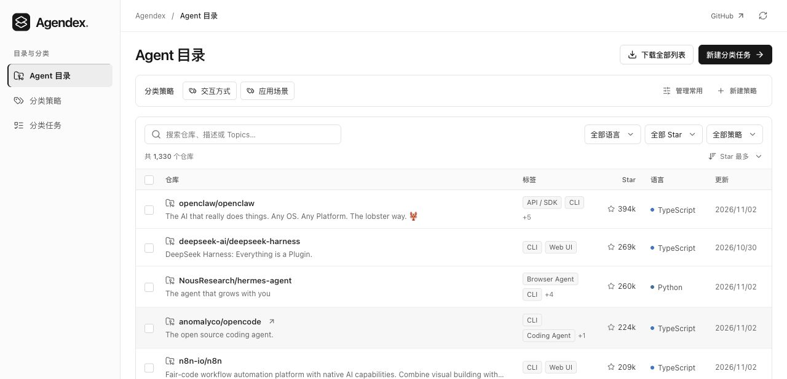

# Agendex

English · [简体中文](README.zh-CN.md)

Agendex is a searchable directory of AI agent implementations on GitHub. It includes a web workspace for browsing repositories, defining classification rules, and tagging repositories with models or by hand.

[Open Agendex](https://agendex.icu/)



## Run locally

Install Python 3.12 and Node.js 22.12 or newer. From the repository root:

```bash
python3.12 -m venv system/web/.venv
system/web/.venv/bin/python -m pip install -r system/web/backend/requirements.lock
npm --prefix system/web ci
```

Follow the [offline example](system/web/examples/catalog/README.md) to build a sample SQLite database and start the app at [localhost:8000](http://127.0.0.1:8000). The example runs without API credentials.

## Build a catalog

The [catalog pipeline](system/pipeline/README.md) covers GitHub discovery, metadata screening, README collection, final screening, and SQLite import. You can also import an existing snapshot offline.

For GitHub collection or model calls, copy [`.env.example`](.env.example) to `.env`, fill in the settings you use, and load them in your shell:

```bash
set -a
. ./.env
set +a
```

See the [web app guide](system/web/README.md) for classification, exports, and development, and the [deployment guide](system/web/deploy/README.md) for self-hosting.

## License

[MIT](LICENSE)
