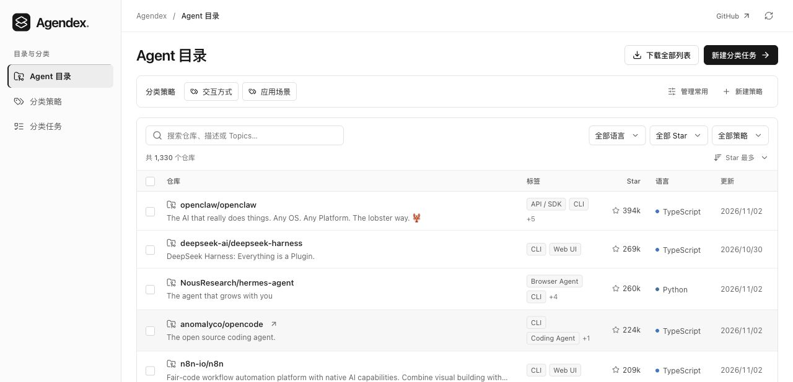

# Agendex

[English](README.md) · 简体中文

Agendex 是一个可检索的 GitHub AI Agent 实现目录。你可以在网站上浏览仓库、定义分类规则，并通过模型或人工为仓库打标签。

[访问 Agendex](https://agendex.icu/)



## 本地运行

安装 Python 3.12 和 Node.js 22.12 或更新版本。在仓库根目录运行：

```bash
python3.12 -m venv system/web/.venv
system/web/.venv/bin/python -m pip install -r system/web/backend/requirements.lock
npm --prefix system/web ci
```

按照[离线样例](system/web/examples/catalog/README.md)建立 SQLite 样例库，再启动网站并访问 [localhost:8000](http://127.0.0.1:8000)。样例无需 API 凭据。

## 建立目录数据库

[建库指南](system/pipeline/README.md)包含 GitHub 候选发现、元数据初筛、README 采集、精筛和 SQLite 导入，也支持从已有快照离线建库。

如需采集 GitHub 数据或调用模型，将 [`.env.example`](.env.example) 复制为 `.env`，填写所需配置并在终端加载：

```bash
set -a
. ./.env
set +a
```

分类、导出与开发方法见[网站使用说明](system/web/README.md)，自托管见[部署指南](system/web/deploy/README.md)。

## 许可证

[MIT](LICENSE)
